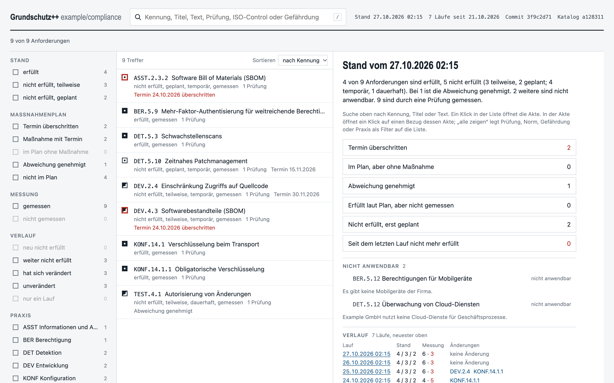
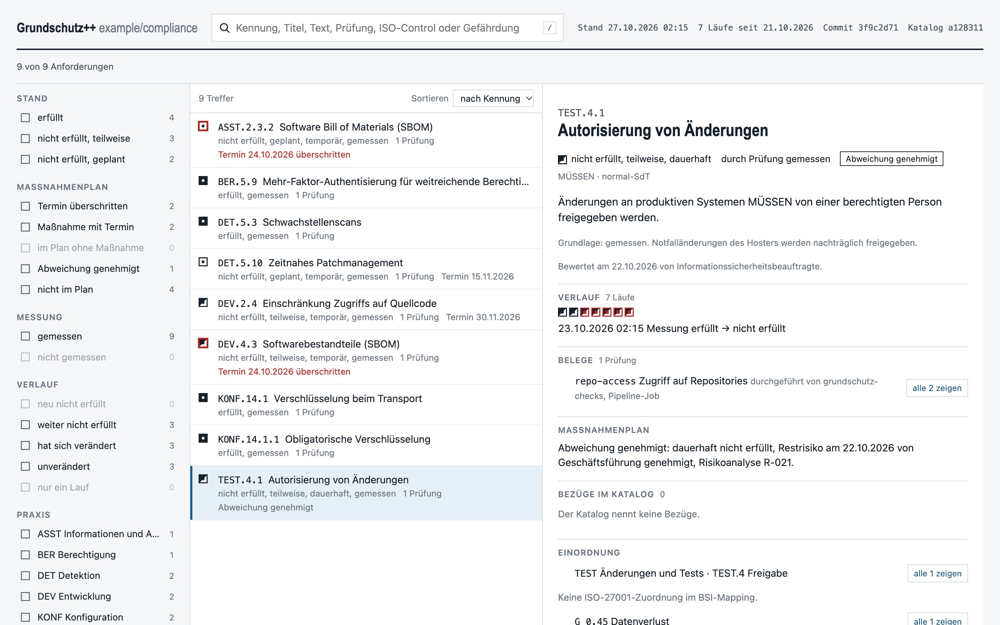
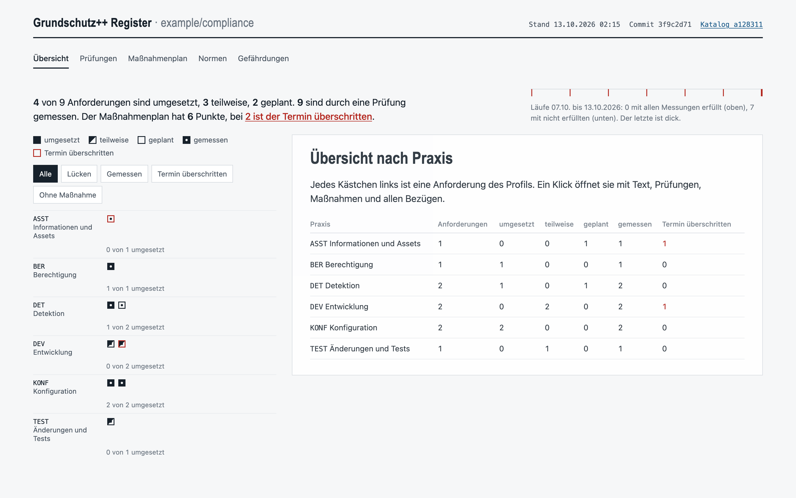

# grundschutz-viewer

Browse the BSI's machine-readable **Grundschutz++** catalog together with what
your own OSCAL documents say about it: one HTML page, no server, readable
offline.

It reads the chain that
[grundschutz-worksheets](https://github.com/ohartwig/grundschutz-worksheets)
writes -- the profile, the security plan (SSP), the assessment plan, assessment
results and the POA&M -- and follows each import through its back-matter to the
profile and the catalog, checking the SHA-256 it names. Which catalog, which
commit of the BSI library and which parameter values apply comes from the
profile, not from the viewer.



One requirement with its history: the measured state per run, oldest left,
and what changed when.



The register: every requirement as a box per practice, with the plan of action
and the standards in their own tabs.



The screenshots show a made-up company, Example GmbH: seven nights of the
worksheets chain with the five
[grundschutz-checks](https://github.com/ohartwig/grundschutz-checks), an owner
review and an improvement register. The page is in German, like the catalog.

## Download

Every release carries a ZIP per platform: Linux (amd64, arm64), macOS (Apple
Silicon, Intel) and Windows (amd64), on the
[releases](https://github.com/ohartwig/grundschutz-viewer/releases) page. Unzip
it and run the one binary in it; there is nothing to install.

The macOS binaries are signed and notarised, so Gatekeeper lets them start.
The Windows binary is not signed; SmartScreen will say so. `SHA256SUMS` lists
every package and comes with a cosign signature, `SHA256SUMS.sig`.

With Go 1.27 or newer, `go install` works as well (below).
`grundschutz-viewer -version` prints the version.

## Usage

```bash
go install github.com/ohartwig/grundschutz-viewer/cmd/grundschutz-viewer@latest

# A folder: read with all its subfolders. One folder per run makes a history.
grundschutz-viewer -o grundschutz.html runs/

# Single files work too, mixed with folders
grundschutz-viewer -o grundschutz.html security-plan.json results-*.json profile.json

# The register layout instead of the explorer
grundschutz-viewer -view register -o register.html runs/
```

| Flag | |
|---|---|
| `-o <file>` | The page to write, `-` for stdout. Default `grundschutz.html`. |
| `-view explorer\|register` | The layout. Default `explorer`. |
| `-offline` | Never fetch; read fetched files from the cache only. Without it, an import that is a URL and not among the inputs (usually the BSI catalog) is fetched, checked against its SHA-256 if one is named, and cached. |

JSON files that are not OSCAL, such as a check's raw output, are skipped.

### Runs and history

A run is a security plan and the documents next to it. Results in a
subdirectory without a plan of its own -- trial checks, for example -- belong
to the run of the nearest directory above them that has one. Runs are ordered
by the end of their results.

The newest run is the state the page shows; every run adds a point to the
history: per requirement the plan's status and the measured state, and per run
what changed against the run before.

### States

The page follows [BSI-Standard
300-1](https://www.bsi.bund.de/SharedDocs/Downloads/DE/BSI/Grundschutz/BSI_Standards/standard_300-1.pdf)
(4.1), the method of Grundschutz++, which knows three states: a requirement
the plan calls implemented is *erfüllt*; partial and planned are both *nicht
erfüllt*, with *teilweise* or *geplant* as the detail; a requirement the
profile leaves out is *nicht anwendbar*, shown with its reason in both
layouts. Where the plan says whether a nonfulfilment is temporary or
permanent, the page shows *temporär* or *dauerhaft*.

A permanent nonfulfilment whose residual risk the leadership approved is an
approved deviation: the POA&M gives its risk the status `deviation-approved`
and no action. The page shows it as *Abweichung genehmigt*, with the date of
the approval, who gave it and the risk analysis, and counts it apart; it is
never listed as an item without an action.

Where the documents name them, the page also shows who reviewed a
requirement and when (`reviewed`, `reviewed-by` in the plan), who is
responsible for an action (`responsible` on a POA&M remediation) and who
performed a check (`performed-by` on a result). Older files without them are
shown as before.

### Imports

Each import is looked up next to the importing file, then by its SHA-256
among all inputs, then by file name. The page lists every import with its
state: checked against the SHA-256, without one, taken as the only candidate
in the same run, a different SHA-256, or missing.

The ISO 27001 column comes from a mapping collection among the inputs, or
else from the BSI's mapping at the catalog's commit.

## Building

```bash
go test ./...
go build ./cmd/grundschutz-viewer
```

## License

MIT, see [LICENSE](LICENSE).
